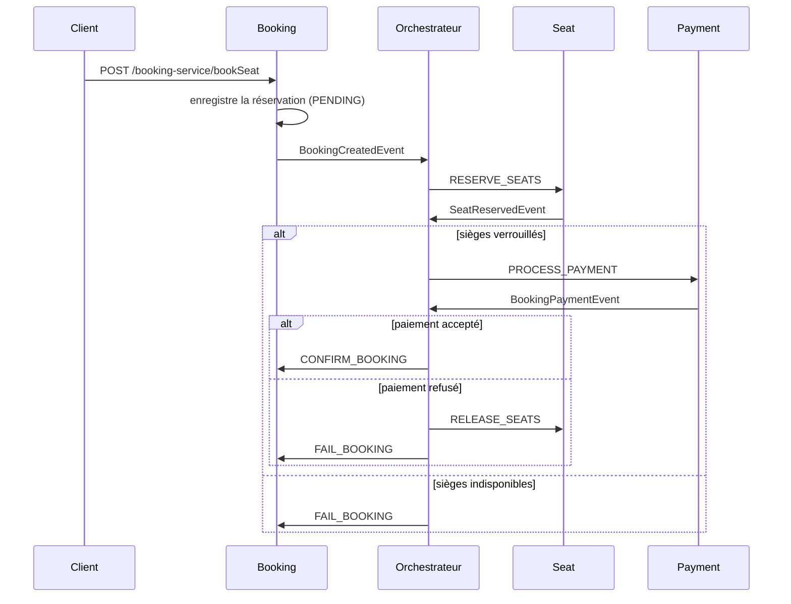

# Réservation de places : saga orchestrée avec Kafka

Système de réservation de places de cinéma en microservices (Spring Boot + Apache Kafka).
Une **saga orchestrée** coordonne la réservation, le verrouillage des sièges et le paiement,
avec **compensation** automatique en cas d'échec.


## Architecture



Les services ne communiquent jamais entre eux : chacun reçoit des **ordres** de l'orchestrateur
et lui répond. Toute la logique de la saga est regroupée dans l'orchestrateur.

## Services

| Service | Rôle | Port |
|---|---|---|
| Booking | Enregistre les réservations, change leur statut | 9191 |
| Seat | Verrouille et libère les sièges | 9292 |
| Payment | Simule le paiement (refusé au-dessus de 2000) | 9393 |
| Orchestrateur | Pilote la saga | 9494 |
| Kafka UI | Visualise les topics et les messages | 8090 |

## Topics Kafka

| Topic | Sens |
|---|---|
| `movie-booking-events` | Booking → Orchestrateur |
| `seat-command-topic` | Orchestrateur → Seat |
| `seat-reserved-topic` | Seat → Orchestrateur |
| `payment-command-topic` | Orchestrateur → Payment |
| `payment-events` | Payment → Orchestrateur |
| `booking-command-topic` | Orchestrateur → Booking |

## Technologies

Java, Spring Boot, Spring for Apache Kafka, JPA / Hibernate, MySQL, Lombok, Docker, Docker Compose.

## Lancer le projet

Prérequis : Docker Desktop.

```bash
docker compose up --build
```

Kafka UI est disponible sur http://localhost:8090.
Pour repartir de zéro (base et topics vides) : `docker compose down`, puis relancer.

## Scénarios de test

La réponse HTTP renvoie `PENDING` : le statut final (`CONFIRMED` ou `FAILED`)
est écrit en base quelques instants plus tard, car la saga est asynchrone.

**1. Succès** (sièges libres, montant ≤ 2000)

```bash
curl -X POST http://localhost:9191/booking-service/bookSeat \
  -H "Content-Type: application/json" \
  -d '{"userId":"user1","showId":"SHOW_101","seatIds":["A1","A2"],"amount":1000}'
```

**2. Paiement refusé** (montant > 2000) : les sièges sont libérés, la réservation passe à `FAILED`

```bash
curl -X POST http://localhost:9191/booking-service/bookSeat \
  -H "Content-Type: application/json" \
  -d '{"userId":"user2","showId":"SHOW_101","seatIds":["A5"],"amount":2500}'
```

**3. Siège déjà pris** : la saga s'arrête avant le paiement, la réservation passe à `FAILED`

```bash
curl -X POST http://localhost:9191/booking-service/bookSeat \
  -H "Content-Type: application/json" \
  -d '{"userId":"user3","showId":"SHOW_101","seatIds":["A3"],"amount":500}'
```

## Ce que j'ai ajouté

- Un **service orchestrateur** qui remplace la chorégraphie initiale (les services s'écoutaient entre eux)
- Un protocole d'ordres et de réponses via Kafka, avec la compensation (libération des sièges) centralisée
- La réservation créée en `PENDING`, puis confirmée ou échouée sur ordre de l'orchestrateur
- La correction d'une double publication de l'événement de paiement réussi
- La conteneurisation : Dockerfiles multi-stage et `docker-compose.yml` pour tout lancer en une commande

## Limites connues et pistes d'amélioration

- L'orchestrateur ne conserve pas l'état des sagas (pas de reprise après un plantage)
- Pas de retries ni de Dead Letter Topic sur les consommateurs
- Les sièges restent `LOCKED` après un paiement réussi (jamais `RESERVED`)
- Pas encore de tests automatisés ni de CI


## Déploiement sur Kubernetes (minikube)

Les manifestes sont dans `k8s/`. Les images sont celles publiées par la CI sur GitHub Container Registry.

Prérequis : minikube avec au moins 4 Go de mémoire.

```bash
minikube start --cpus=max --memory=4096

kubectl apply -f k8s/00-namespace.yml
kubectl apply -f k8s/10-mysql.yml
kubectl apply -f k8s/20-kafka.yml
kubectl wait -n saga --for=condition=available deployment/mysql deployment/kafka --timeout=300s
kubectl apply -f k8s/21-kafka-topics-job.yml
kubectl wait -n saga --for=condition=complete job/kafka-init --timeout=300s
kubectl apply -f k8s/30-config.yml
kubectl apply -f k8s/40-apps.yml
```

Kubernetes n'a pas d'équivalent de `depends_on` : `kubectl wait` impose l'ordre (MySQL et Kafka, puis les topics,
puis les applications).

Test de bout en bout : ouvrir un tunnel vers Booking dans un terminal, puis lancer le script dans un second.

```bash
kubectl port-forward -n saga svc/booking-service 9191:9191
bash scripts/e2e-k8s.sh
```

Nettoyage : `kubectl delete namespace saga`.

Les mots de passe des manifestes sont des valeurs de démonstration : dans un vrai projet, on utilise un gestionnaire de secrets.

### Ce que Kubernetes apporte ici

- **Auto-réparation** : un Pod supprimé est recréé par son Deployment.
- **Résilience** : si l'orchestrateur est arrêté, les réservations restent dans Kafka et sont traitées à son retour.
- **Mise à l'échelle** : `kubectl scale -n saga deploy/payment-service --replicas=2` répartit les 3 partitions
  du topic entre les copies.


## Observabilité

Chaque service expose ses métriques (`/actuator/prometheus`, via Spring Boot Actuator et Micrometer).
Prometheus les collecte toutes les 10 secondes, et Grafana affiche un tableau de bord chargé automatiquement.

| Outil | Adresse |
|---|---|
| Prometheus | http://localhost:9090 |
| Grafana | http://localhost:3000 (admin / admin, valeurs de démonstration) |

Le tableau de bord « Saga de réservation » montre l'état des services, le nombre de sagas confirmées et échouées
(avec la cause de l'échec), le trafic HTTP, la mémoire et le retard des consommateurs Kafka.

Les métriques métier (`saga_started_total`, `saga_completed_total`) sont produites par l'orchestrateur.
Les étiquettes (`outcome`, `reason`) ont un nombre limité de valeurs : on n'y met jamais un identifiant de réservation,
car chaque valeur différente créerait une nouvelle série dans Prometheus.